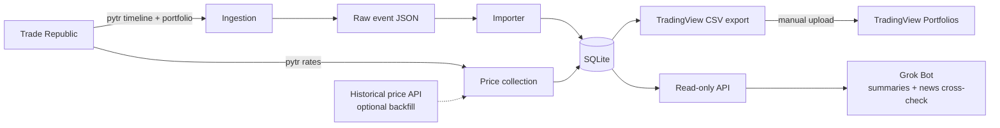

# portfolio-tracker

A self-hosted, read-only tracker for my Trade Republic account. It runs on the homelab and is deployed with Nix.

> Status: planning. This README is the plan; there is no implementation yet.

## Goals

- Pull holdings and transactions from Trade Republic automatically, on a schedule.
- Keep a local history I own: positions, cash, transactions, dividends.
- Track daily market value per holding, so the bot can report value changes and top movers.
- Use [TradingView Portfolios](https://www.tradingview.com/support/solutions/43000760937-tradingview-portfolios-track-your-assets-know-your-trades/) as the dashboard: generate a CSV it can import, so it handles prices, value over time and charts.
- Expose a small read-only API so a Grok Bot can send daily or weekly summaries and cross-check news on my holdings.
- Be reproducible: one NixOS module, declarative config, secrets out of Git.

## Non-goals

- No trading, order placement, or any write action against Trade Republic. Ever.
- No custom dashboard UI for now. TradingView covers charts.
- No multi-user support, no public exposure. Homelab and tailnet only.
- No tax reporting engine (exports are fine; tax logic is not).
- No time-weighted or money-weighted returns for now. See [Valuation](#valuation).
- No real-time quotes. One price per holding per day is enough.

## Architecture

One daily sync job runs the steps in order: ingestion, import, reconciliation, price collection, CSV export. One job means pytr runs never overlap, and Trade Republic sees one session per day.

1. **Ingestion.** [pytr](https://github.com/pytr-org/pytr) (unofficial Trade Republic client) fetches the timeline and the current portfolio. The Rust app calls it as a subprocess with a timeout and keeps the raw timeline event JSON (`all_events.json`). The simplified `export_transactions` CSV is not enough: it drops event IDs, and one event can produce several postings.
2. **Importer.** Parses the raw events with `serde` into typed events and writes them to SQLite in one transaction. Imports are idempotent: rows are keyed by event ID plus leg, so re-running over the same export changes nothing. Events that Trade Republic revises are updated in place; cancelled ones are marked cancelled, never deleted. Event types the importer doesn't recognise fail the import with the raw event attached, instead of being skipped. The importer only reads files, so pytr can be swapped or the exports replayed.
3. **Reconciliation.** Derives holdings and cash from transactions and compares them with what pytr reports. A mismatch raises an alert and marks the day incomplete.
4. **Price collection.** Records one price per held ISIN per day. See [Prices](#prices).
5. **TradingView export.** Writes the full transaction history as a CSV in [TradingView's import format](https://www.tradingview.com/support/solutions/43000756010-how-to-create-a-portfolio-via-transaction-import/). I upload it by hand into a TradingView portfolio.
6. **API and bot hook.** Read-only JSON endpoints (`/positions`, `/summary?period=week`, `/movers?period=week`, `/dividends`, `/transactions`) behind a token, so a bot can build summaries and look up news per holding. Every response includes `as_of`, the last successful sync and a `complete` flag, so a failed sync can't pass for current data.
7. **Read-only scope.** Nothing in the system can place or cancel orders.

### TradingView import

- Columns: `Symbol, Side, Qty, Fill Price, Commission, Closing Time`, comma-separated, with a header row. One bad line rejects the whole file.
- `Symbol` is `EXCHANGE:TICKER` (e.g. `XETR:VWCE`), taken from the [instrument mapping](#instrument-mapping). TradingView has no ISIN lookup on import.
- Instrument sides: `buy`, `sell`, `dividend`, `split`, `reward`. Cash rows use symbol `$CASH` with `deposit`, `withdrawal`, `income` (interest), `taxes and fees`.
- Field meanings differ by side:
  - `dividend`: `Qty` is the total amount paid, not a share count. `Fill Price` and `Commission` are ignored.
  - `split`: `Qty` is the quantity before the split, `Fill Price` the quantity after.
  - Cash rows: `Qty` is the amount, in the portfolio currency (EUR).
- `Closing Time`: `YYYY-MM-DD hh:mm:ss` or `YYYY-MM-DDTHH:mm:ss.sssZ`. Use the event timestamp so rows stay distinct.
- Import merges by default and skips rows whose six fields match exactly. The export must be deterministic (stable rounding, timestamps, ordering), or a re-upload creates duplicates. Two genuine transactions with identical fields would also be merged into one; Phase 0 checks whether that happens in practice. For corrections, use replace mode.
- TradingView can [download all transactions as CSV](https://www.tradingview.com/support/solutions/43000756105-transactions-page/), useful for a round-trip check. There is no public portfolio API, so uploads stay manual and the bot reads from the local DB.
- The number of transactions a portfolio can hold depends on the TradingView plan. Saving plans and dividends add rows every month.

### Prices

Prices come from providers behind a `PriceSource` trait, so they can be swapped.

- **Daily: pytr `rates`.** Fetches prices from Trade Republic by ISIN, so no ticker mapping is needed. It returns the latest quote from the first venue that answers, not an official close, and an ISIN with no quote can be missing from the output. The sync runs at a fixed time after Trade Republic's venue (LS Exchange) closes at 23:00 Berlin, so each day's price is taken at the same cutoff.
- **Backfill: optional, no provider chosen.** Free tiers don't cover this well: [Twelve Data](https://twelvedata.com/exchanges/xetr) needs a paid plan for Xetra, and [EODHD](https://eodhd.com/pricing) free only goes back one year (20 calls/day). Without backfill, local value history starts with the first sync; TradingView still shows the long-term chart. If a provider is added, its prices fill only the days before collection started, so one day never mixes a TR quote with another provider's close.

Rules:

- Every price records `basis` (`last` or `close`), `observed_at`, `venue`, `currency` and `source`.
- A missing price carries forward the last known one for up to 3 trading days, marked stale. After that the holding has no value for the day and the day is marked incomplete.
- Prices in a currency other than EUR are rejected until FX conversion exists. pytr quotes in EUR, so this only matters for a backfill provider.

### Valuation

- **Portfolio value** on a day = sum of (quantity held × that day's price) + cash.
- **Period change** = end value − start value − net external flows (deposits − withdrawals).
  - Deposits and withdrawals are not gains or losses.
  - Buys and sells move money between cash and securities and don't change the value.
  - Dividends and interest count as gains; fees and taxes count as losses.
- **Per-holding change** (for `/movers`) = price change × quantity, with buys and sells during the period counted at their execution price.
- No result is shown for a period with an incomplete day or a stale price beyond the carry-forward limit. The API returns `complete: false` instead.
- Time-weighted return needs a valuation around every cash flow, which daily prices can't give. Add it later only if the simple period change turns out not to be enough.

### Instrument mapping

A small file in the repo, `instruments.toml`, maps each ISIN to its symbol for each consumer: the TradingView symbol, and the backfill provider's ticker if one is added. Each entry also records the venue and quote currency, since one ISIN can trade on several exchanges in several currencies. The CSV export and the backfill fail with a clear error for any held ISIN without an entry, rather than guessing.

### Known risks with pytr

- It is unofficial and reverse-engineered; it can break whenever Trade Republic changes its API.
- Login needs occasional confirmation on the phone (device pairing / 2FA), so ingestion can't be fully unattended forever. Re-authenticating means running `pytr login` by hand as the service user; the steps go in the README once known.
- Using it may sit in a grey area of Trade Republic's terms. Keep request volume low.

Mitigations: a timeout on every pytr call, a few retries with backoff and then a failure, an alert when the sync fails or the session expires, raw exports kept so a later importer can replay them, and the importer kept separate from pytr so the client can be swapped.

## Data model sketch

Money and quantities are exact decimals (`rust_decimal` in code, text in SQLite), never floats; fractional shares are normal on Trade Republic. Trade Republic settles everything in EUR, so transaction amounts are EUR.

| Table | Key columns |
| --- | --- |
| `instruments` | `isin` (PK), `name`, `type` (stock, ETF, crypto, bond) |
| `transactions` | (`event_id`, `leg`) PK, `ts`, `isin` (null for cash), `kind`, `quantity`, `price`, `amount`, `fee`, `tax`, `saving_plan` (bool), `status` (active, cancelled), `raw_json` |
| `positions_snapshots` | `snapshot_date`, `isin`, `quantity`, `avg_cost` |
| `cash_snapshots` | `snapshot_date`, `balance` |
| `prices` | (`isin`, `date`) PK, `price`, `currency`, `basis`, `observed_at`, `venue`, `source`, `stale` (bool) |
| `sync_runs` | `id`, `started_at`, `finished_at`, `status`, `step`, `error`, `complete` (bool) |

Transaction rules:

- `kind`: buy, sell, dividend, interest, deposit, withdrawal, fee, tax, reward (Saveback, bonus shares), split, corporate_action (merger, spin-off, ISIN change), transfer_in, transfer_out, opening_balance.
- Saving plan executions are `buy` with `saving_plan = true`.
- `amount` is the signed net effect on cash (positive in, negative out), fees and taxes included. `fee` and `tax` are broken out for reporting only and never subtracted again.
- Splits and corporate actions change quantities explicitly. Prices are stored unadjusted, so a split is never counted twice.
- If the timeline doesn't reach back to the account's opening, an `opening_balance` row per holding and for cash sets the starting point.

Positions and cash are derived from transactions; snapshots are the cross-check against what Trade Republic reports.

## Tech stack

| Layer | Choice |
| --- | --- |
| Language | Rust (stable), one binary with `sync`, `serve` and `export` subcommands via `clap` |
| Async runtime | `tokio` |
| Trade Republic client | pytr CLI, run with `tokio::process::Command` inside `tokio::time::timeout` |
| Parsing | `serde` / `serde_json` for pytr events and `instruments.toml`, `csv` for the TradingView export |
| Money | `rust_decimal` |
| Errors | a `thiserror` enum (session expired, pytr failed, parse failed, reconciliation mismatch) in library code, `anyhow` at the binary edge |
| Database | SQLite via `sqlx` (compile-time checked queries, built-in migrations), WAL mode and a busy timeout |
| Prices | pytr `rates` daily; backfill provider undecided, via `reqwest` if added |
| API | `axum` |
| Logging | `tracing`, to the systemd journal |
| Dashboard | TradingView Portfolios via CSV import |

pytr stays a Python CLI. The Rust binary owns everything around it: the sync job, the importer, price collection, the CSV export and the API. My default for personal backends is Effect; this repo uses Rust instead for exact decimals, strict parsing and simple Nix packaging.

## Nix deployment

- Package the app with a flake using `crane` (`packages.default`, `devShells.default` with the Rust toolchain, `sqlx-cli` and pytr). `checks` run `cargo clippy` and `cargo test`.
- `sqlx` offline mode (`.sqlx/` query metadata in the repo), so Nix builds don't need a database.
- pytr is a runtime dependency of the sync job; package it in the flake if nixpkgs doesn't have a usable version.
- Ship a NixOS module: `services.portfolio-tracker.enable`, a systemd service for the API, and one oneshot sync service with a daily timer.
- The pytr session and the database live in the service's `StateDirectory` (`/var/lib/portfolio-tracker`), writable only by the service user.
- Wire it into `nix-config` as another homelab service, behind the existing reverse proxy and tailnet only.
- Secrets via sops-nix, like the rest of the homelab.

## Security

- Trade Republic credentials (phone number, PIN), the API token and any price API key live in sops-encrypted secrets, readable only by the service user.
- The pytr session is mutable state, not a secret pinned in config: it stays in the `StateDirectory` with mode `0600`.
- The service runs as its own user with systemd hardening (`ProtectSystem`, `PrivateTmp`, no extra capabilities).
- API is read-only, token-protected, and not exposed outside the tailnet.
- No code path that can trade; pytr is used only for read commands.
- Back up the database and raw exports, and test a restore; they hold financial history.

## Roadmap

1. **Phase 0: spike.** Run pytr by hand and confirm the login flow.
   - Check that the raw events cover the full history, including fractional trades, saving plans, Saveback and any splits.
   - Check which command writes `all_events.json`, what `pytr rates` returns, and how often it can be called.
   - Download TradingView's sample CSV, import a few hand-made rows, and download them again to confirm the round trip and the merge behaviour.
   - Check whether any backfill provider covers the actual holdings, and at what price.
2. **Phase 1: ingestion.**
   - Cargo project and flake, SQL migrations, idempotent importer with tests built from the Phase 0 event samples, reconciliation.
   - Daily price collection starts here, because a missed day can't be collected later.
   - Daily sync timer, failure and session-expiry alerts, backups with a tested restore.
3. **Phase 2: TradingView.** Instrument mapping, deterministic CSV export, first full import into a TradingView portfolio.
4. **Phase 3: valuation.** Portfolio value, period change and per-holding change, once holdings and cash reconcile. Backfill if Phase 0 found a provider worth paying for.
5. **Phase 4: API and bot.** Read-only endpoints and token; bot sends weekly summaries with value changes, top movers and news per holding.
6. **Phase 5: polish.** NixOS module cleanup, re-authentication docs, anything Phases 1–4 deferred.

## Alternatives considered

- **Custom dashboard (Grafana or a small SPA).** More control, but means building charts. TradingView does this already; revisit if the CSV workflow gets painful.
- **[Ghostfolio](https://github.com/ghostfolio/ghostfolio).** Self-hosted and has an API, but no native Trade Republic sync and another service to run. Fallback if TradingView's plan limits or manual uploads become a problem.
- **[Portfolio Performance](https://www.portfolio-performance.info/).** Excellent analytics and imports TR PDFs, but it's a desktop app, not a service with an API.
- **[Wealthfolio](https://wealthfolio.app/).** Now has a [self-hosted web edition](https://wealthfolio.app/docs/guide/self-hosting/) in Docker, an HTTP API and an MCP server for agents. No Trade Republic sync, so pytr and an importer are still needed, but it could replace the local valuation, dashboard and bot API. Open question: evaluate before Phase 3.
- **Google Finance.** No portfolio API or import, so syncing would mean browser automation. No transaction or dividend history.
- **Google Sheets with `GOOGLEFINANCE()`.** Has an API, but poor coverage of European ETFs and exchanges, and the data lives in Google.

The reason to build: automated TR ingestion, data I own, and an API a bot can use. TradingView is only the viewer; the local DB stays the source of truth.
