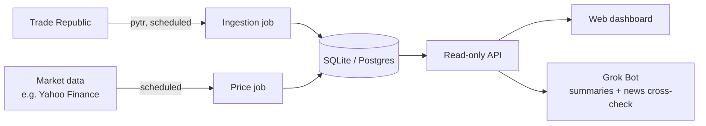

# portfolio-tracker

A self-hosted, read-only tracker for my Trade Republic account. It runs on the homelab and is deployed with Nix.

> Status: planning. This README is the plan; there is no implementation yet.

## Goals

- Pull holdings and transactions from Trade Republic automatically, on a schedule.
- Keep a local history I own: positions, cash, transactions, dividends.
- Show current value, value over time, performance and dividends in a simple web dashboard.
- Expose a small read-only API so a Grok Bot can send daily or weekly summaries and cross-check news on my holdings.
- Be reproducible: one NixOS module, declarative config, secrets out of Git.

## Non-goals

- No trading, order placement, or any write action against Trade Republic. Ever.
- No multi-user support, no public exposure. Homelab and tailnet only.
- No tax reporting engine (exports are fine; tax logic is not).
- No real-time quotes. End-of-day or delayed prices are enough.

## Architecture

1. **Ingestion.** [pytr](https://github.com/pytr-org/pytr) (unofficial Trade Republic client) runs on a timer, exports the timeline and portfolio, and a small importer normalises them into the database. Imports must be idempotent: re-running over the same export changes nothing.
2. **Prices.** A separate job fetches current and historical prices for every held instrument (ISIN mapped to a ticker) from a free source such as Yahoo Finance.
3. **Dashboard.** A simple web UI: positions, allocation, value over time, performance (absolute and time-weighted), dividends received.
4. **API and bot hook.** Read-only JSON endpoints (`/positions`, `/summary?period=week`, `/dividends`, `/transactions`) behind a token, so a bot can build summaries and look up news per holding.
5. **Read-only scope.** Nothing in the system can place or cancel orders.

### Known risks with pytr

- It is unofficial and reverse-engineered; it can break whenever Trade Republic changes its API.
- Login needs occasional confirmation on the phone (device pairing / 2FA), so ingestion can't be fully unattended forever.
- Using it may sit in a grey area of Trade Republic's terms. Keep request volume low.

Mitigations: alert when ingestion fails or the session expires, keep raw exports so a later importer can replay them, and keep the importer separate from pytr so the client can be swapped.

## Data model sketch

| Table | Key columns |
| --- | --- |
| `instruments` | `isin` (PK), `name`, `ticker`, `type` (stock, ETF, crypto, bond), `currency` |
| `transactions` | `id` (TR event id), `ts`, `isin`, `kind` (buy, sell, dividend, interest, deposit, withdrawal, fee, tax, saving plan), `quantity`, `price`, `amount`, `fee`, `tax`, `raw_json` |
| `positions_snapshots` | `snapshot_date`, `isin`, `quantity`, `avg_cost` |
| `cash_snapshots` | `snapshot_date`, `balance` |
| `prices` | `isin`, `date`, `close`, `currency`, `source` |
| `ingest_runs` | `id`, `started_at`, `finished_at`, `status`, `error` |

Positions can be derived from transactions; snapshots are a cross-check against what Trade Republic reports.

## Tech stack options

| Layer | Option A (simple) | Option B (more structure) |
| --- | --- | --- |
| Database | SQLite | Postgres (already on the homelab?) |
| Ingestion and API | Python (same language as pytr), FastAPI | Python ingestion + TypeScript API |
| Dashboard | Server-rendered HTML + a chart lib, or Grafana on the DB | Small SPA (React/Svelte) |
| Prices | `yfinance` | A paid API later if Yahoo proves flaky |

Leaning: SQLite + Python + FastAPI, and try Grafana before building a custom UI.

## Nix deployment

- Package the app with a flake (`packages.default`, `devShells.default`).
- Ship a NixOS module: `services.portfolio-tracker.enable`, a systemd service for the API, and systemd timers for ingestion and prices.
- Wire it into `nix-config` as another homelab service, behind the existing reverse proxy and tailnet only.
- Secrets via sops-nix, like the rest of the homelab.

## Security

- Trade Republic credentials (phone number, PIN) and the pytr session live in sops-encrypted secrets, readable only by the service user.
- The service runs as its own user with systemd hardening (`ProtectSystem`, `PrivateTmp`, no extra capabilities).
- API is read-only, token-protected, and not exposed outside the tailnet.
- No code path that can trade; pytr is used only for read commands.
- Back up the database; it holds financial history.

## Roadmap

1. **Phase 0: spike.** Run pytr by hand, look at the export format, confirm the login flow.
2. **Phase 1: ingestion.** Schema, idempotent importer, systemd timer, failure alerts.
3. **Phase 2: prices.** ISIN-to-ticker mapping, daily prices, backfilled history.
4. **Phase 3: dashboard.** Positions, value over time, performance, dividends.
5. **Phase 4: API and bot.** Read-only endpoints and token; bot sends weekly summaries and news per holding.
6. **Phase 5: hardening.** Backups, session-expiry alerts, NixOS module polish.

## Alternatives considered

- **[Ghostfolio](https://github.com/ghostfolio/ghostfolio).** Self-hosted and polished, but no native Trade Republic sync; you'd still need pytr plus an importer. Could be the dashboard instead of building one.
- **[Portfolio Performance](https://www.portfolio-performance.info/).** Excellent analytics and imports TR PDFs, but it's a desktop app, not a service with an API.
- **[Wealthfolio](https://wealthfolio.app/).** Local-first desktop app, nice UI, same problem: no headless service or API for a bot.
- **Google Finance.** Easy watchlist, but manual entry, no transactions or dividend history, no API.

The reason to build: automated TR ingestion, data I own, and an API a bot can use. Revisit Ghostfolio as the UI layer before Phase 3.
