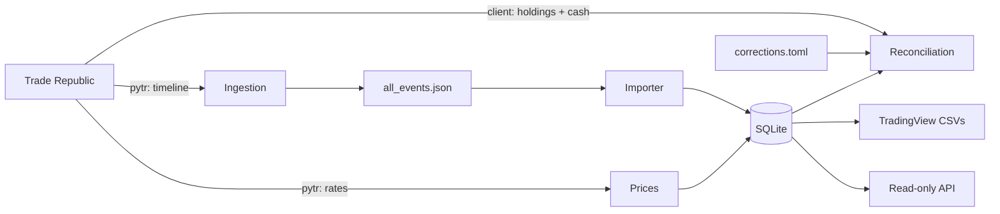

# Design

## Data flow

One daily `sync` runs the steps in order, so pytr runs never overlap and Trade Republic sees one session a day:

1. **Ingestion.** pytr writes the full timeline with details to `all_events.json`: a full fetch the first time, the last 14 days afterwards, merged into the same file.
2. **Import.** Events are parsed with `serde` and written to SQLite in one transaction, keyed by event ID and leg. Re-importing changes nothing, revised events are updated in place, and cancelled ones are kept as cancelled. An unknown event type fails the import rather than being skipped.
3. **Reconciliation.** Holdings and cash per account, derived from transactions plus corrections, are compared with what Trade Republic reports for each account. Mismatches, negative holdings and negative cash are recorded per run.
4. **Prices.** One price per held ISIN per day, from `pytr rates`.
5. **Export.** One TradingView CSV per account, if an instruments file is configured.

Trade Republic's data and API are described in [trade-republic-notes.md](trade-republic-notes.md).

## Trade Republic client

`src/trade_republic.rs` is a read-only WebSocket client for the data pytr can't fetch: holdings and cash for every account, including a PEA.

- It reuses pytr's cookie jar, refreshes `tr_session` in memory with the `tr_refresh` cookie, and never writes the jar.
- It can subscribe to three topics only: `accountPairs`, `compactPortfolioByType` and `cash`. Order, savings plan and payout topics have no code path.
- A rejected refresh or an authentication error becomes `SessionExpired`.

pytr remains responsible for logging in, the timeline and prices.

## Ledger

Every event becomes zero or more postings:

| Field | Meaning |
| --- | --- |
| `account` | `regular` or `pea`, from `cashAccountNumber`. Events without one go to the regular account, except corporate actions, which go to whichever account held the parent security. |
| `kind` | buy, sell, dividend, interest, deposit, withdrawal, fee, tax, reward, corporate_action, transfer_in, internal_transfer, opening_balance, adjustment (`split` and `transfer_out` are reserved). |
| `quantity` | Signed change in shares held. |
| `amount` | Signed effect on cash, fees and taxes included. `fee` and `tax` are broken out for reporting and never subtracted again. |
| `status` | `active` or `cancelled`. Cancelled postings are ignored everywhere. |

Money and quantities are exact decimals (`rust_decimal`, stored as text), never floats. Trade Republic settles in EUR; prices in other currencies are rejected until FX conversion exists.

A `PEA_DEPOSIT_DEBIT` becomes two `internal_transfer` legs: out of the regular account and into the PEA. A card deposit becomes a deposit plus a separate fee leg.

## Corrections

`corrections.toml` records what the timeline doesn't contain. Each entry is either securities (`isin` + `quantity`, optional `price`) or cash (`amount`), of kind `opening_balance` or `adjustment`, with a date and a note. Corrections become postings like any other.

`corrections-template` proposes entries from the last sync's snapshots:

- If one quantity on the first day of the account's history closes a holding's gap without any running total going negative, it becomes an `opening_balance`.
- Cash gets the smallest opening balance that keeps it non-negative, plus an `adjustment` dated today for whatever remains.
- Anything else becomes an `adjustment` dated today.

The proposals never fill in `price`, because Trade Republic's average buy-in is unreliable for transferred shares.

## Valuation

- **Value** on a day: Σ(quantity × price) + cash.
- **Period change** over `(start, end]`: end value − start value − net external flows.
  - External flows are deposits, withdrawals and cash corrections.
  - For a single account, internal transfers count as flows too; for both accounts together they cancel out.
  - Buys and sells move value between cash and securities. Dividends and interest are gains; fees and taxes are losses.
- **Movers**: per holding, end value − start value − the cost of shares traded in the period, at their execution price.
- **Prices** are carried forward up to 3 trading days and marked stale. After that the holding has no value.
- **Incomplete** results return `complete: false` and no number. A result is incomplete when:
  - a holding has no price;
  - a holding or cash balance is negative;
  - the period contains shares that moved without an execution price (opening balances, adjustments, transfers, corporate actions).

Time-weighted returns would need a valuation around every cash flow, which daily prices can't give, so the tracker doesn't report them.

## TradingView export

[TradingView's import format](https://www.tradingview.com/support/solutions/43000756010-how-to-create-a-portfolio-via-transaction-import/): `Symbol, Side, Qty, Fill Price, Commission, Closing Time`.

- `Symbol` is `EXCHANGE:TICKER` from `instruments.toml`. The export fails with the list of unmapped ISINs.
- Trades are `buy`/`sell` with fees and taxes as commission. Dividends are `dividend` with the total paid as `Qty`. Gifted shares are `reward`.
- Cash rows use `$CASH` with `deposit`, `withdrawal`, `income` or `taxes and fees`. Internal transfers are a deposit on one side and a withdrawal on the other.
- Transferred shares (opening balances with a `price`) become a `buy` plus a matching `$CASH` deposit, so cash is unchanged. Without a `price`, the export fails.
- Output is byte-for-byte stable. TradingView's merge import only skips rows whose six fields match exactly, so a re-upload doesn't create duplicates.

## Storage

SQLite in WAL mode via `sqlx`, with compile-time checked queries and offline metadata in `.sqlx/`. The schema is in [`migrations/`](../migrations/).

| Table | Contents |
| --- | --- |
| `accounts` | Which cash account is regular and which is the PEA. |
| `raw_events` | Every timeline event as received. |
| `instruments` | ISIN and name. |
| `transactions` | Postings. |
| `prices` | One price per ISIN per day, with basis, observation time and source. |
| `sync_runs` | Status, step, error and completeness per run. |
| `positions_snapshots`, `cash_snapshots` | What Trade Republic reported in each run. |
| `reconciliation_issues` | Mismatches found in each run. |

## Why these choices

- **pytr plus a small client** instead of a full reimplementation: pytr's community keeps the login and bot-check code working when Trade Republic changes it.
- **Rust**: exact decimals, strict parsing of an undocumented format, and a single binary that's easy to package with Nix.
- **TradingView as the dashboard**: it already has prices, charts and performance views; this project only feeds it.
